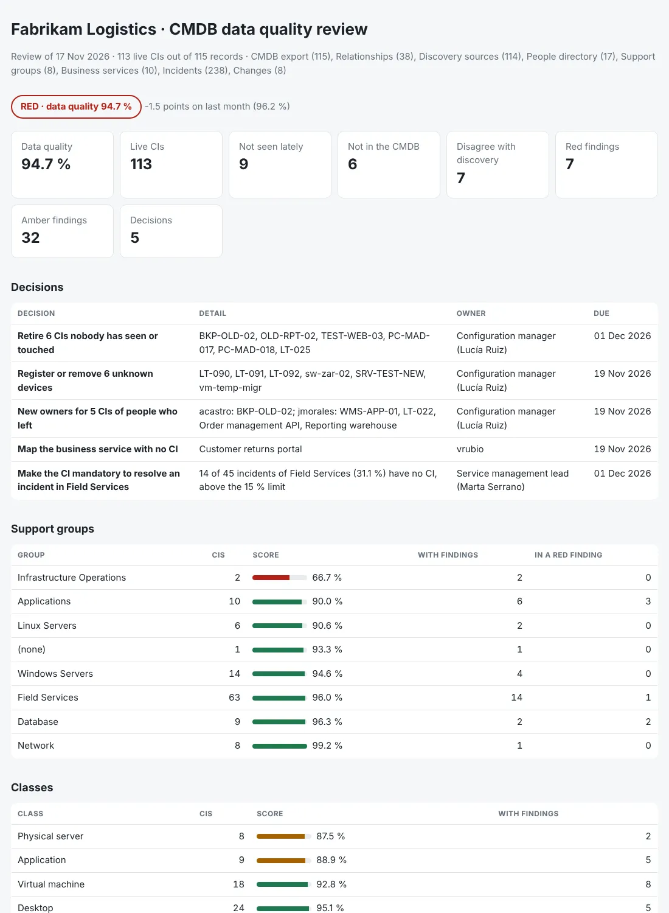

# CMDB Data Quality Review

The question for the configuration manager and the support group leads every month: can we trust the CMDB? From the CMDB export, its relationships, what the discovery sources see (Active Directory, Intune, vCenter, a network scan), the people directory, the support groups, the business services and the incidents and changes of the month, it puts together:

- **Completeness:** the fields each class needs (owner, support group, location, serial, IP, operating system, service, criticality), with critical CIs first.
- **Accuracy:** live CIs no discovery source has seen lately (and which of them nobody needs: candidates to retire), devices on the network with no CI, records that disagree with discovery on the address, the operating system or the location, duplicates, and retired CIs that are still checking in.
- **Ownership:** CIs owned by people who left and CIs assigned to support groups that no longer exist.
- **Relationships:** applications and databases with nothing to run on, relationships to CIs that do not exist or were retired, and business services with no CI mapped.
- **Process:** the share of each group's incidents logged with no CI, incidents logged against retired CIs, changes implemented on retired CIs and changes that left the record behind.

Every finding has an owner and a due date, every CI, class and support group gets a **data quality score**, the choices (what to retire, what to register, new owners, services to map, the CI mandatory on incidents) become **decisions**, and `review-pack.md` is the page for the monthly review.

Python 3.10+, standard library only. It runs with fictional demo data out of the box. A read-only PowerShell script exports the computers Active Directory knows about.

It sits next to [38-it-asset-lifecycle-planner](https://github.com/inigogonzalezgarcia/38-it-asset-lifecycle-planner), which plans the hardware refresh, and [46-problem-management-review](https://github.com/inigogonzalezgarcia/46-problem-management-review), which looks at the problems behind repeat incidents.



## Why

A CMDB is only useful if people trust it, and it loses that trust a record at a time:

- a server was switched off in the summer and is still operational in the CMDB, so the impact analysis of a change counts it;
- a test VM someone created for a migration is on the network with no owner, no group and no record;
- a laptop retired in September is still checking in to Intune;
- three PCs were upgraded to Windows 11 under a change, and the records still say Windows 10;
- the owner of the order management API left in October;
- the finance reports application still runs on a server retired in June, and a change was implemented on that server last week;
- a critical business service has no CI mapped, so an outage cannot be traced to it;
- one support group logs a third of its incidents with no CI, so nobody can see which devices fail.

Each tool shows its own part. The review reads them together and turns the result into a short list of fixes and decisions. The rules are in `settings.json` and `cmdbreview/checks.py`.

## What it checks

| Area | Code | Finding | Severity |
|---|---|---|---|
| Completeness | CI-MISSING | A field its class needs is empty | AMBER (RED if critical) |
| Accuracy | CI-STALE | Live CI not seen by any source lately; a candidate to retire when no ticket, change or live CI needs it | AMBER (RED if critical) |
| Accuracy | CI-UNREGISTERED | Seen lately, no CI | AMBER (RED if a server or network device) |
| Accuracy | CI-MISMATCH | IP address, operating system or location differ from discovery | AMBER |
| Accuracy | CI-DUPLICATE, CI-RETIRED-SEEN | Two live records for one device; retired CI seen after its retirement | AMBER; RED |
| Ownership | OWN-LEFT, OWN-GROUP | Owner disabled or gone; support group not active | AMBER (RED if critical); AMBER |
| Relationships | REL-DANGLING, REL-RETIRED | Relationship to a CI that does not exist; live CI depends on a retired one | AMBER; RED |
| Relationships | REL-ORPHAN, REL-SERVICE-EMPTY | Application or database with nothing it runs on; business service with no CI | AMBER (RED if critical) |
| Process | PROC-INC-NO-CI, PROC-INC-RETIRED | Group's incidents without CI above the limit; incidents on retired CIs | AMBER |
| Process | PROC-CHG-RETIRED, PROC-CHG-NOT-UPDATED | Change on a retired CI; change implemented after the record's last update | RED; AMBER |

[docs/data-format.md](docs/data-format.md) has every rule, column, setting and how the score is calculated.

## Outputs

| File | What |
|---|---|
| `report.html` | Score with its trend, tiles, the decisions, the support groups and classes by score, every finding by area, the devices nobody registered and the records that disagree with discovery |
| `review-pack.md` | One page for the monthly review: result, headlines, decisions, groups, red findings, process figures and sources |
| `ci-quality.csv` | One row per CI: class, status, criticality, group, owner, service, last seen and by which source, score and findings |
| `unregistered.csv`, `mismatches.csv` | Devices with no CI; every field where the CMDB and discovery disagree |
| `relationships-review.csv` | Every relationship and what is wrong with it |
| `group-scorecard.csv`, `process.csv` | Score per support group; incidents with no CI and on retired CIs per group |
| `findings.csv`, `actions.csv` | Every finding with severity, items, owner and due date; the same as actions with a reference and a done column |

## Try it

```bash
git clone https://github.com/inigogonzalezgarcia/56-cmdb-data-quality-review.git
cd 56-cmdb-data-quality-review
python -m cmdbreview demo
```

Open `output/report.html` and `output/review-pack.md`.

### The demo data

The demo is a made-up logistics company, Fabrikam Logistics, with a head office and data room in Madrid, a warehouse in Zaragoza and a sales office in Valencia: 115 records (113 live) across servers, VMs, desktops, laptops, network devices, storage, applications and databases, 114 discovery rows from four sources, 17 people, 8 support groups, 10 business services, and the 238 incidents and 8 changes of the last 30 days. The review runs on Tuesday 17 November 2026.

Everything is fictional: names, serials, addresses and tickets. The problems are placed on purpose among records that are fine:

- **Accuracy:** 9 live CIs nobody has seen lately, among them a critical legacy SQL server a reporting database still runs on, and 6 that nobody needs; 6 devices on the network with no CI (a migration VM, a test server, a switch in Zaragoza and three laptops); 7 records that disagree with discovery (three re-addressed VMs, three PCs upgraded to Windows 11, a laptop that moved site); a laptop registered twice after a re-image; a laptop retired in September still checking in to Intune.
- **Ownership:** five CIs owned by two people who left, one of them the order management API; two CIs in a support group that was merged; gaps in serials, owners, a group and a criticality.
- **Relationships:** the finance reports application runs on a server retired in June; two relationships to deleted VMs; two applications with nothing to run on; the customer returns portal with no CI mapped.
- **Process:** 31 % of Field Services incidents with no CI; three incidents on retired CIs; a change implemented on the retired server; three Windows 11 upgrades that did not update the records.

The result: **RED**; data quality 94.7 % (1.5 points down on last month); 7 red and 32 amber findings and 5 decisions: retire six records, register or remove six devices, new owners for five CIs, map the customer returns portal, and make the CI mandatory on Field Services incidents.

## Use it with your own data

1. Export (read-only):
   ```powershell
   .\scripts\Export-DiscoveryAD.ps1 -SearchBase "OU=Computers,DC=contoso,DC=local" -OutputFolder .\data
   ```
   It reads every computer with `Get-ADComputer` (name, operating system, address, last logon) and changes nothing.
2. Add the rest:
   - `cis.csv` and `relationships.csv` from your CMDB (ITSM tool export or report);
   - more rows in `discovery.csv` from Intune, vCenter, a network scan or your discovery tool (same columns);
   - `people.csv` from the directory, `groups.csv`, `services.csv`, and `incidents.csv` and `changes.csv` for the month;
   - `data/settings.json`: required fields per class, days before a CI is stale, thresholds and owners ([docs/data-format.md](docs/data-format.md) has every column and setting).
3. Build the outputs:
   ```bash
   python -m cmdbreview review data/
   ```

[docs/review-runbook.md](docs/review-runbook.md) has the monthly cycle, how to read the result (can you trust what it says is there, does it say the right things, does someone answer for it, can an outage be traced, does the process feed it), how to retire, register and merge records without losing history, and what to keep as evidence for the audit.

The exports contain host names, addresses, serials, user names and ticket data. Keep them inside your organisation:

- real files at the top level (`cis*.csv`, `relationships*.csv`, `discovery*.csv`, `people*.csv`, `groups*.csv`, `services*.csv`, `incidents*.csv`, `changes*.csv`, `settings.json`, `data/`) and the `output/` folder are excluded from Git by `.gitignore`;
- only the fictional files in `sample_data/` are committed.

## Tests

```bash
pip install -r requirements-dev.txt
python -m pytest -q
```

GitHub Actions runs them on Python 3.10 and 3.12 on every push, checks that the committed sample data is what the simulator writes, and keeps the demo report and a screenshot as build artifacts.

15 tests: the parsers (classes, statuses, criticality, operating system versions, names with a domain); a clean CMDB with no findings; missing fields by class; stale CIs and candidates to retire, and a stale CI that is still needed; unregistered devices and retired devices still seen; mismatches and an operating system written in other words; duplicates; owners who left and inactive groups; relationships and empty services; incidents and changes; other column names and semicolons; a missing CMDB export; the demo end to end; and a deterministic demo.

## Next steps

- Run it on the first working day of every month and keep the score as `previous_score` for the trend.
- Read the CMDB and the discovery sources straight from their APIs instead of CSV exports.
- Open the RED actions as tickets in the ITSM tool with the owner and due date.
- Add the score per support group to the service management dashboard.

## Background

Built from my work running IT service management and site operations:

- process ownership for incident and request, change (CAB) and problem management, with process dashboards;
- CMDB and configuration management, and answering audits;
- ITSM tools such as EasyVista, GLPI and HaloITSM, and Device42 for the inventory of the comms rooms;
- PowerShell automation.

Written from scratch with fictional data; no employer data, systems or exports are used.

## Customisation and contact

Want this adapted to your environment? For example:

- your CMDB classes, required fields and thresholds;
- your sources: your ITSM tool's API, your discovery tool, Intune or vCenter;
- your support groups, services and owners;
- the pack in the format of your monthly review.

Get in touch:

- Website (contact form): [inigogonzalezgarcia.github.io](https://inigogonzalezgarcia.github.io/about.html#contacto)
- LinkedIn: [linkedin.com/in/igonzalez93](https://www.linkedin.com/in/igonzalez93)

## License

MIT
